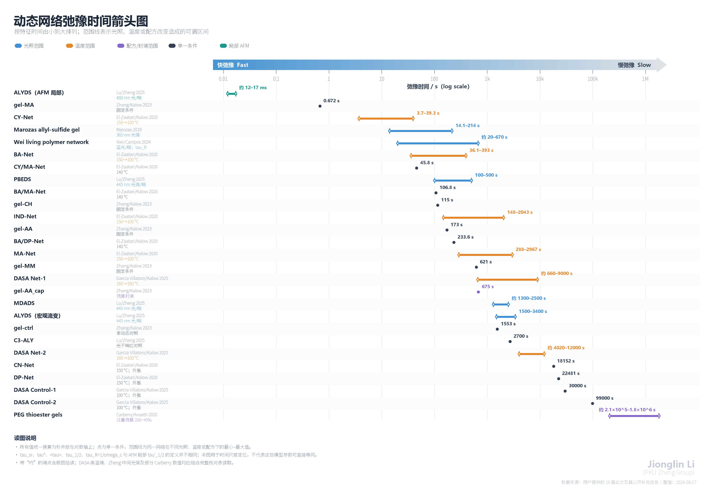

# 19 篇光响应/动态网络论文：材料弛豫时间总表
Jionglin Li 
- PKU Zheng Group

整理日期：2026-08-27。范围为用户提供的 19 份 PDF。本文只把作者明确定义的机械应力弛豫时间、蠕变迟滞时间、频率交叉时间和分子光异构恢复半衰期列为“时间常数”；照射时长、固化时间、降解时间、形状锁定时间和普通实验观察窗口不冒充弛豫时间。

## 先看结论

图中按范围最小值从快到慢排列；蓝色、橙色、紫色范围分别表示光照、温度和配方变化，深灰点为单一条件，绿色为 AFM 局部测量。矢量版见 `assets/cans-relaxation-time-arrow.svg`，作图数据见 `notes/relaxation-time-arrow-data.csv`。

- 19 篇中，**7 篇给出了材料机械弛豫时间或可对应的流变时间常数**：Marozas 2019、Carberry 2020、El-Zaatari/Kalow 2020、Zhang/Kalow 2023、Wei/Campos 2024、Garcia Villatoro/Kalow 2025、Lu/Zheng 2025。
- Rosales/Anseth 2015 给的是偶氮苯 **cis→trans 热恢复半衰期**，不是应力弛豫时间，单独收录。
- 其余 11 篇虽然研究光诱导交换、塑性、降解、形状重构或反应路径，但没有报告可核实的单一机械弛豫时间。对这些文章明确写“未报告”，避免从曲线或曝光时长强行造出 τ。
- 文中“精确”表示正文/表格直接给数；“图估读”表示从坐标图读取，保留近似号；“重算”表示依据补充信息的三次原始重复计算算术平均值 ± 样本标准差。

## 一、机械应力弛豫与相关流变时间

### 1. Marozas et al., New Journal of Physics (2019)

**论文：** *Photo-induced viscoelasticity in cytocompatible hydrogel substrates*，DOI 10.1088/1367-2630/ab1309。

**材料：** PEG-D/I–allyl sulfide 水凝胶；网络内带 I2959 自由基前体，365 nm 光触发 AFCT 型烯丙基硫醚交换。作者用 Zener 模型分别拟合应力弛豫常数 τ_sr 和蠕变迟滞常数 τ_c。

| 365 nm 光强（均照 10 s） | τ_sr，应力弛豫（s） | 数据性质 |
| --- | ---: | --- |
| 0.5 mW cm⁻² | 214 ± 47 | 正文精确 |
| 2.5 mW cm⁻² | 约 80 | Figure 3d 图估读 |
| 5 mW cm⁻² | 约 50 | Figure 3d 图估读 |
| 7.5 mW cm⁻² | 约 35 | Figure 3d 图估读 |
| 10 mW cm⁻² | 约 17 | Figure 3d 图估读 |
| 15 mW cm⁻² | 14.1 ± 2.6 | 正文精确 |

| 365 nm 光强（均照 10 s） | τ_c，蠕变迟滞（s） | 数据性质 |
| --- | ---: | --- |
| 2.5 mW cm⁻² | 158 ± 31 | 正文精确 |
| 5 mW cm⁻² | 约 90 | Figure 3f 图估读 |
| 7.5 mW cm⁻² | 约 72 | Figure 3f 图估读 |
| 10 mW cm⁻² | 约 70 | Figure 3f 图估读 |
| 15 mW cm⁻² | 约 60 | Figure 3f 图估读 |
| 20 mW cm⁻² | 约 54 | Figure 3f 图估读 |
| 25 mW cm⁻² | 47 ± 17 | 正文精确 |

**解释：** 这是同一配方在不同光强下得到的多个时间常数；光强越大，自由基生成越快，τ_sr 和 τ_c 均缩短。τ_c 是蠕变响应，不应与 τ_sr 混为一个量。

### 2. Carberry et al., Annals of Biomedical Engineering (2020)

**论文：** *Phototunable Viscoelasticity in Hydrogels Through Thioester Exchange*，DOI 10.1007/s10439-020-02460-w。

**材料：** PEG thioester 水凝胶，以过量自由巯基驱动硫酯交换。作者用拉伸指数模型计算平均应力弛豫时间 ⟨τ⟩。

| 过量巯基（相对化学计量） | ⟨τ⟩（s） | 数据性质 |
| ---: | ---: | --- |
| 0% | 约 1.8 × 10⁶ | Figure 2d 图估读 |
| 50% | 约 1.4 × 10⁶ | Figure 2d 图估读 |
| 100% | 约 7.4 × 10⁵ | 摘要/正文给出约 740,000 s |
| 150% | 约 6.0 × 10⁵ | Figure 2d 图估读 |
| 200% | 约 2.1 × 10⁵ | Figure 2d 图估读 |

**解释：** 实测窗口约 5400 s，以上 ⟨τ⟩ 大幅超出窗口，是模型外推量。光封端自由巯基后，应力弛豫明显关闭，但作者没有给封端后的新 τ，因此不能写成“τ = ∞”。

### 3. El-Zaatari, Ishibashi & Kalow, Polymer Chemistry (2020)

**论文：** *Cross-linker control of vitrimer flow*，DOI 10.1039/D0PY00233J。

**材料：** 巯基接枝 PDMS 与 6 种 dithioalkylidene 交联剂构成的 vitrimer。CY、BA、IND、MA 的 τ* 按归一化模量降到 1/e 读取；极慢的 CN、DP 用拉伸指数外推。下表“均值 ± SD”由补充信息的三个样品值重算，括号保留三个原值。

| 网络 | 100 °C τ*（s） | 120 °C | 130 °C | 140 °C | 150 °C |
| --- | ---: | ---: | ---: | ---: | ---: |
| CY-Net（cyclohexanedione） | 39.3 ± 3.1（42, 40, 36） | 14.2 ± 3.1（17.7, 11.6, 13.3） | 9.6 ± 1.8（11.4, 7.76, 9.50） | 6.6 ± 1.3（8.00, 5.37, 6.50） | 3.7 ± 0.2（3.50, 3.67, 3.99） |
| BA-Net（barbituric acid） | 393 ± 187（272, 299, 609） | 156 ± 96（80, 125, 264） | 95.2 ± 69.1（44.9, 66.8, 174） | 72.8 ± 66.5（26.8, 42.5, 149） | 36.1 ± 26.1（15.9, 26.8, 65.6） |
| IND-Net（indanedione） | 2043 ± 762（1790, 1440, 2900） | 839 ± 243（699, 699, 1120） | 439 ± 113（315, 465, 536） | 287 ± 63（232, 274, 356） | 148 ± 63（150, 83.8, 210） |
| MA-Net（Meldrum’s acid） | 2967 ± 473（3500, 2600, 2800） | 1043 ± 25（1040, 1070, 1020） | 800 ± 101（901, 700, 800） | 442 ± 25（422, 435, 470） | 288 ± 43（323, 240, 300） |
| CN-Net（malonitrile） | 未给 | 未给 | 未给 | 未给 | 18,152 ± 13,146（7152, 14592, 32711） |
| DP-Net（diphenylpropanedione） | 未给 | 未给 | 未给 | 未给 | 22,481 ± 2564（22122, 20115, 25205） |

**混合交联网络（140 °C，拉伸指数拟合）：** CY/MA-Net：τ = 45.785 ± 0.223 s，β = 0.55；BA/MA-Net：106.799 ± 0.240 s，β = 0.83；BA/DP-Net：233.629 ± 1.256 s，β = 0.54。CY/MA 和 BA/DP 的连续谱显示多个模态，但作者没有把每个谱峰都数值化为独立 τ；这里保留整体拟合参数，不虚构分峰数值。

### 4. Zhang et al., Chem (2023)

**论文：** *Tailoring dynamic hydrogels by controlling associative exchange rates*，DOI 10.1016/j.chempr.2023.05.018。

**材料与条件：** 4-arm PEG-thiol / norbornene 光成胶的水凝胶，HEPES（0.1 M，pH 7.44），约 1 kPa；5% 应变应力弛豫，单 Maxwell 元件拟合，τ 为 3 组数据平均。

| 材料 | 交联结构/处理 | τ（s） |
| --- | --- | ---: |
| gel-MA | Meldrum’s acid dithioalkylidene | 0.672 |
| gel-CH | 计算设计的中等交换速率交联剂 | 115 |
| gel-AA | acyclic acceptor | 173 |
| gel-MM | methyl-substituted acceptor | 621 |
| gel-AA_cap | gel-AA 的自由巯基经 norbornene 封端 | 675 |
| gel-ctrl | 非动态对照；慢弛豫来自悬垂链等背景模态 | 1553 |

**解释：** gel-CH 的 49.8 s 和 53.7 s 是模型预测值，实测值是 115 s；总表只把 115 s 当作材料数据。gel-AA 封端后从 173 s 变成 675 s，说明自由巯基参与关联交换。

### 5. Wei et al., Advanced Materials (2024)

**论文：** *Light-Induced Living Polymer Networks with Adaptive Functional Properties*，DOI 10.1002/adma.202313961。

**材料：** 含 thiuram disulfide 的“living polymer network”。作者由频率扫描的 G′/G″ 交叉角频率定义 τ_R = 1/ω_c。

| 条件 | τ_R |
| --- | ---: |
| 暗态 | 约 670 s |
| 蓝光照射 | 约 20 s |

**核对提醒：** 原文给出的 τ_R 数字、坐标上的交叉频率与角频率/普通频率换算存在约 2π 的表观不一致；总表保留作者明示的 670 s 和 20 s，并把它们标为“频率交叉时间”，不改写成应力阶跃拟合 τ。

### 6. Garcia Villatoro et al., Journal of the American Chemical Society (2025)

**论文：** *Donor–Acceptor Stenhouse Adducts as Intrinsically Photoswitchable Dynamic Covalent Bonds*，DOI 10.1021/jacs.5c11859。

**材料：** DASA 作为交联动态键的聚合物网络；应力弛豫用拉伸指数拟合。

| 网络 | 100 °C τ | β / 说明 |
| --- | ---: | --- |
| Net-1 | 150 min | β = 0.47，正文精确 |
| Net-2 | 200 min | β = 0.44，正文精确 |
| Control-1 | 500 min | 外推值 |
| Control-2 | 1650 min | 外推值 |

Figure 8 的 Arrhenius 图还展示了高温点；图估读如下：Net-1 在 120、140、160 °C 约为 74、18、11 min；Net-2 约为 122、82、67 min。由于这些点未在正文表格逐项列数，应视为近似读图值。

**光照影响：** 作者没有报告“照光后新的应力弛豫 τ”。40 °C 蠕变中 Net-2 的暗态速率约 0.12% h⁻¹，绿光 3 mW cm⁻² 下约 0.01% h⁻¹；这是蠕变速率，不是 τ，故不塞入 τ 表。

### 7. Lu et al., Nature Communications (2025)

**论文：** *Visible light-responsive hydrogels for cellular dynamics and spatiotemporal viscoelastic regulation*，DOI 10.1038/s41467-024-54880-0。

**材料：** Schiff 碱提供本征弛豫，TDS 提供可见光加速交换。作者主要用半应力时间 τ_1/2，即应力降为初值一半所需时间。

| 材料/实验 | 暗态 τ_1/2 | 光照 τ_1/2 | 说明 |
| --- | ---: | ---: | --- |
| ALYDS，宏观流变光强序列 | 3400 ± 410 s | 5 mW cm⁻² 约 2600 s；10 mW cm⁻² 约 2150 s；20 mW cm⁻² 约 1800–1900 s；40 mW cm⁻² 1500 ± 230 s | 中间三点为 Figure 2d 图估读 |
| ALYDS，五轮开/关循环 | 3400 ± 410 s | 20 mW cm⁻²：1500 ± 230 s | 与上行 20 mW 点略不同，属于协议/表述差异，分别保留 |
| ALYDS，AFM 局部弛豫 | 约 17 ms | 488 nm、5 mW cm⁻²：约 12 ms | Figure 3c 插图估读；局部毫秒尺度不能与宏观流变秒尺度直接等同 |
| MDADS | 约 2400–2500 s | 20 mW cm⁻²：约 1300–1400 s | Figure 1/2b 图估读 |
| PBEDS | 500 s | 20 mW cm⁻²：200 s；40 mW cm⁻²：100 s | 正文给出时间尺度，Figure 2b/d 支持 |
| C3-ALY（无 TDS 控制） | 2700 s | 约 2700 s，不随光变 | 正文控制实验 |
| PRODS（有 TDS、无 Schiff 碱） | 约 27,200 s | 未给单一数值 | 正文只说暗态约比 ALYDS 慢 8 倍；此值为 8 × 3400 s 的推算，不是作者直接报数 |

**解释：** 该文同一个 ALYDS 在剂量序列与重复开关协议中，20 mW cm⁻² 的数值存在约 1500 与约 1800–1900 s 两种表述；这里不强行合并。材料的宏观流变 τ_1/2、AFM 局部 τ′_1/2 和细胞实验配方也不应被当作同一测量。

## 二、分子/模量恢复时间，不是机械应力弛豫

### Rosales et al., Biomacromolecules (2015)

**论文：** *Photoresponsive Elastic Properties of Azobenzene-Containing Poly(ethylene-glycol)-Based Hydrogels*，DOI 10.1021/bm501710e。

**材料：** 含偶氮苯肽交联剂的 PEG-VS 水凝胶。365 nm（10 mW cm⁻²，5 min）把 trans 转为 cis 并软化；随后 cis→trans 热恢复按一级动力学处理。

| 温度 | cis→trans 热恢复半衰期 |
| --- | ---: |
| 25 °C | 162.3 h |
| 37 °C | 9.2 h |

这两个值描述光异构体/弹性模量恢复，不是应力阶跃实验的机械 τ。

## 三、其余论文：没有可核实的单一机械弛豫时间

| 编号 | 论文与材料 | 核对结果 |
| ---: | --- | --- |
| 1 | Amamoto et al., Adv. Mater. 2012，thiuram disulfide 交联聚合物 4a–4e | 未报告 τ。4a 在 25 °C、200/100 kPa 蠕变约 150 min 达平衡，4e 在窗口内持续流动；150 min 是观察到平衡的实验时间，不是拟合弛豫常数。 |
| 2 | Xi et al., Macromolecules 2014，photocaged superbase 触发 thiol–Michael 两阶段网络 | 未报告机械应力弛豫 τ；重点是光碱释放、空间图案化和不可逆二次交联。 |
| 3 | Brown et al., Adv. Mater. 2017，allyl sulfide AFCT 光降解细胞水凝胶 | 未报告机械 τ；文中的秒级量是光引发剂/网络降解或反凝胶时间。 |
| 4 | McBride et al., Adv. Mater. 2017，allyl sulfide 液晶网络 | 有光诱导应力释放/塑性曲线，但没有给单一拟合 τ。 |
| 6 | Yavitt et al., Adv. Mater. 2020，不同硫醇结构的 allyl sulfide 光降解水凝胶 | 未报告机械 τ；文章比较的是降解动力学与类器官传代。 |
| 7 | Davidson et al., Adv. Mater. 2020，3D 打印 allyl sulfide 液晶弹性体 | 未报告机械 τ；约 180 s 的完全形状锁定是工艺/照射时间。 |
| 9 | Yavitt et al., Sci. Adv. 2023，光诱导黏弹性调控肠类器官 | 使用 30、60、120、180 s 光剂量改变局部网络，但没有把材料拟合为单一 τ。 |
| 12 | Reisinger et al., JACS 2025，光酸开启酯交换的 MF1/MF2 | Figure 4 给光 ON/OFF 下的应力曲线和累计 ON 时间（总计 840 min），没有报告特征 τ 或 t_1/2；“relaxation time”轴是经过时间。 |
| 14 | Zhu et al., Adv. Mater. 2021，香豆素可光裂解/重组水凝胶 | 未报告机械应力弛豫 τ；重点是梯度交联、重构和三维变形。 |
| 16 | Zhao et al., CCS Chem. 2024，二硫键非平衡小分子/聚合体系 | 未报告材料机械 τ；重点是光控制反应路径。 |
| 17 | Scott et al., Science 2005，allyl sulfide 交联聚合物 | 有不同 MDTO 浓度和光照下的应力释放曲线，但没有给特征 τ；DOI 为 10.1126/science.1110505。 |

## 四、横向比较时应采用的口径

1. **先对齐定义。** τ_sr、τ*、⟨τ⟩、τ_1/2 和 1/ω_c 不是同一个数学量，数值不能在没有模型换算的情况下直接排序。
2. **再对齐测试尺度。** Zheng 2025 的 AFM 局部毫秒时间与整体流变的千秒时间相差多个数量级，反映探针尺度、局部结构和载荷方式不同。
3. **保留温度和光条件。** Kalow 2020/2025 的热激活网络对温度极敏感；Marozas、Wei、Zheng 则把光强或光开关直接作为速率旋钮。
4. **图估读不伪装成精确值。** 图中只有柱/点、正文未列数字的条目统一写“约”。
5. **未报告就是未报告。** 曲线看起来能“估一个半衰期”并不等于作者报告了材料常数；需要二次数字化和重新拟合时，应另立分析任务并给出模型与误差。

## 五、来源文件对应关系

本报告逐份核对了用户提供的 19 个 PDF，文件名顺序与第三部分编号一致；El-Zaatari/Kalow 2020 的逐温度重复值还核对了论文公开补充信息。网站未修改原始 PDF，也未向外部服务发布或同步本地内容。
